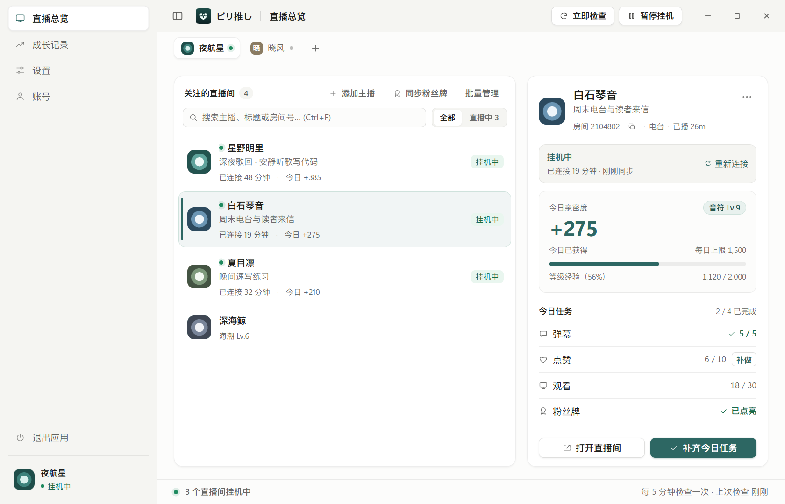
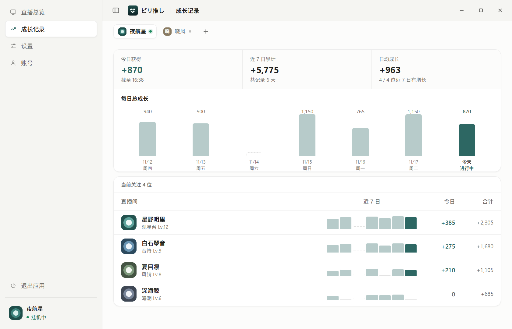
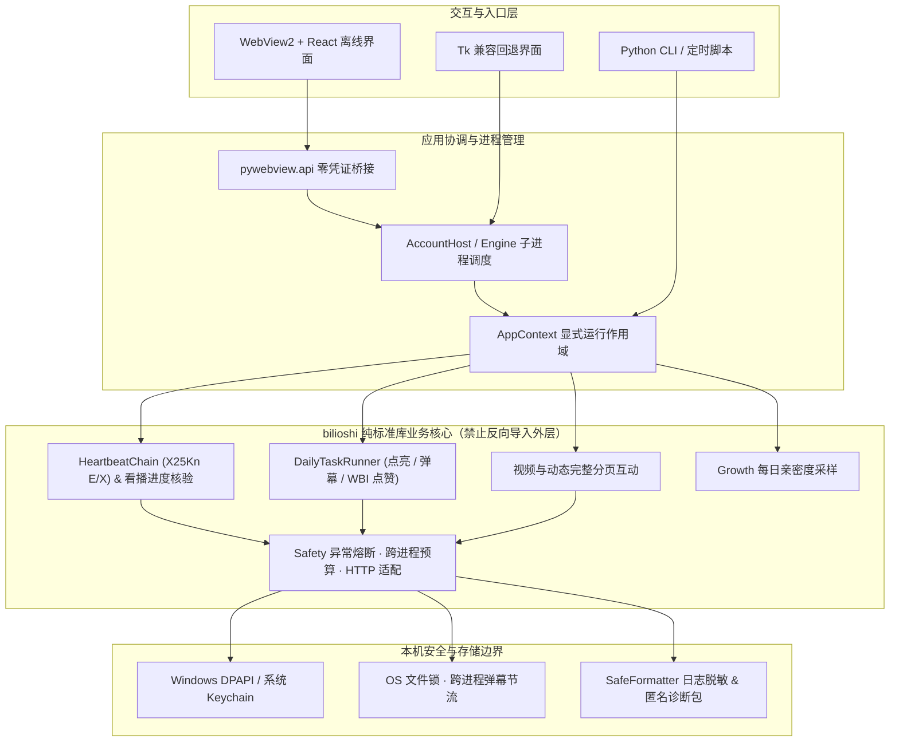

<div align="center">
  
  <h1>ビリ推し · BiliOshi</h1>
  <p><strong>后台替你守着推し的那盏灯。</strong></p>
  <p>克制、可靠、安静常驻的 B 站直播应援桌面工作台与 Python 命令行工具</p>

  <p>
    <a href="https://github.com/craig9re5/BiliOshi/actions/workflows/ci.yml"></a>
    
    
    <a href="LICENSE"></a>
  </p>

  <p>
    <a href="#设计理念">设计理念</a> ·
    <a href="#界面一览">界面一览</a> ·
    <a href="#核心特性">核心特性</a> ·
    <a href="#快速开始">快速开始</a> ·
    <a href="#命令行工具">命令行工具</a> ·
    <a href="#架构与安全">架构与安全</a> ·
    <a href="#常见问题">常见问题</a> ·
    <a href="#文档地图">文档地图</a>
  </p>
</div>

<br />

<picture>
  <source media="(prefers-color-scheme: dark)" srcset="docs/images/overview-dark.png" />
  <source media="(prefers-color-scheme: light)" srcset="docs/images/overview-light.png" />
  
</picture>

<p align="center">
  <sub>Windows 桌面工作台「直播总览」—— 离线打包 WebView2 + React 本地界面，支持跟随系统深浅外观与多账号切换（示意图使用合成演示数据）</sub>
</p>

---

## 设计理念

多数直播辅助脚本要么停留在缺乏状态反馈的定时轮询，要么在接口抖动或触发风控时盲目重试。**ビリ推し（BiliOshi）** 围绕长期后台常驻的可靠性重新设计了整套执行链路：

<table>
  <tr>
    <td width="50%" valign="top">
      <strong>以服务端账本为唯一真源</strong><br /><br />
      不按本地发送次数臆测任务完成。每次互动前先读取 B 站服务端任务缺额，达标即停；直播点赞在接口返回 <code>code=0</code> 后仍延迟复查任务进度。查询超时或异常如实标记为「待更新」，绝不伪装成“未开播”或“已完成”。
    </td>
    <td width="50%" valign="top">
      <strong>风控感知与未知结果熔断</strong><br /><br />
      遇到 <code>HTTP 429</code> / <code>-509</code> 自动遵循服务端 <code>Retry-After</code> 退避冷却；触发 <code>-352</code> / <code>412</code> 验证拦截、房间禁言或写请求超时结果未知时，立即停止写操作并保留当日尝试预算，等待人工核对确认后再恢复。
    </td>
  </tr>
  <tr>
    <td width="50%" valign="top">
      <strong>系统级凭据密封与前端零信任</strong><br /><br />
      Windows 原生采用当前系统用户 DPAPI（<code>UI_FORBIDDEN</code>）加密会话，macOS / Linux 强制使用系统 Keychain 或 Secret Service，无安全后端时直接拒绝明文落盘。WebView2 渲染层不持有 Cookie、不直连 B 站接口；日志与一键诊断包全程自动脱敏。
    </td>
    <td width="50%" valign="top">
      <strong>桌面工作台与 CLI 同核驱动</strong><br /><br />
      零第三方依赖的纯标准库核心（<code>bilioshi</code>）同时驱动 WebView2 桌面端、Tk 兼容界面与全套命令行脚本。不同入口共用 OS 跨进程文件锁、弹幕节流间隔与每日配额，手动补齐与自动巡检互不冲突。
    </td>
  </tr>
</table>

## 界面一览

<picture>
  <source media="(prefers-color-scheme: dark)" srcset="docs/images/growth-dark.png" />
  <source media="(prefers-color-scheme: light)" srcset="docs/images/growth-light.png" />
  
</picture>

<p align="center">
  <sub>「成长记录」按账号与 UTC+8 自然日记录关注主播今日及近 7 日亲密度涨幅（保留 90 天），严格区分有效 <code>0</code>、尚未同步与未记录虚线槽位</sub>
</p>

- **直播总览工作台**：支持通过房间号、短号、UID 或直播间链接解析添加主播，或一键同步已有粉丝牌；提供 `Ctrl+F` 快速检索、开播状态筛选、批量移除、单任务独立补做与单房间重连。
- **多账号管理与免扫码切换**：每个账号独立保存加密凭证、关注列表、挂机策略与任务额度；顶部标签可无副作用查阅非活动账号上次快照，确认切换时直接激活目标账号而无需重新扫码。
- **五套精细主题与无障碍适配**：内置「跟随系统」（可单独指定白天默认主题）、「纸白」、「暖纸白」、「雾青灰」与「墨青暗」配色，全套弹窗与右键菜单支持完整键盘焦点导航。

## 核心特性

| 模块 | 实现机制与行为边界 |
| --- | --- |
| **开播检测与观看心跳** | 提供稳健（5 分钟）/ 激进（1 分钟）两档巡检策略；采用 X25Kn `E/X` 链式签名并严格遵循服务端心跳间隔；每 5–10 分钟核验看播任务进度，连续停滞时提醒并在限次内自动重建心跳链 |
| **粉丝牌点亮与弹幕任务** | 点亮粉丝牌与每日弹幕亲密度分阶段独立开关；先读缺额再发送，跨进程共享发送间隔（10 秒 / 6 秒）与每日硬上限（每 UID / 房间 / 日最多 35 次），北京时间跨日自动重核 |
| **直播间自动点赞** | 默认关闭；复用扫码登录建立的账号与设备会话，经 WBI 签名分批上报并在心跳空档延迟复核任务进度，单日每房间最多执行 15 批 |
| **视频与动态互动（CLI）** | 支持按指定月份或最近天数分页拉取并校验分页完整性；视频默认仅点赞（`--coin` 投币、`--fav` 收藏需显式开启），动态按日期点赞，拉取残缺直接返回失败码 |
| **常驻守护与睡眠恢复** | 独立 `--supervisor` 守护进程监控主程序健康度，意外退出按退避拉起，主动退出同步停驻；系统睡眠唤醒自动赋予心跳宽限期，避免误报断连 |
| **日志轮转与脱敏诊断** | 主程序与各账号日志独立分目录轮转留存；支持从设置页、托盘菜单或 `--export-diagnostic` 一键生成剥离凭证且默认匿名化身份的 `.zip` 诊断包 |

> [!IMPORTANT]
> **平台结算与合规边界**：每日任务完成状态均以 B 站服务端返回进度为准；接口调用成功不代表亲密度必定实时入账，项目不承诺固定收益。BiliOshi 仅面向个人日常应援减负，不提供绕过平台验证、伪造设备指纹、代理轮换或多账号并发挂机能力（同一时间仅运行一个挂机账号）。

## 快速开始

### 方式一：Windows 发行包运行 / 安装（免 Python 环境）

适用于 **Windows 10 / 11**。解压 Release 压缩包后可直接双击 `BiliOshi.exe` 启动；如需部署到 `%LOCALAPPDATA%\Programs\BiliOshi`、自动收紧数据目录 ACL 权限并注册系统登录自启守护任务，可执行：

```powershell
powershell -ExecutionPolicy Bypass -File .\Install-Desktop.ps1 -Activate
```

> [!TIP]
> 桌面端默认使用系统自带的 **Microsoft Edge WebView2 Runtime** 渲染；若运行在移除 WebView2 的精简版系统上，程序会自动无缝回退至内置的 **Tk 兼容界面**（也可通过 `--tk` 参数手动指定）。

### 方式二：从源码运行桌面端（需 CPython 3.11+）

仓库已提交预编译的前端生产资源，直接运行**无需安装 Node.js**：

```powershell
git clone https://github.com/craig9re5/BiliOshi.git
cd BiliOshi
python -m pip install -r requirements-desktop.txt
python tray_app.py --show
```

### 三步上手配置

1. **扫码添加账号**：打开左侧「账号」页点击「添加账号」，使用手机端 B 站 App 扫码确认（无需安装浏览器插件或手工抓取 Cookie）。
2. **导入关注直播间**：在「直播总览」点击「添加主播」（支持房号、短号、UID 或直播间 URL）或「同步粉丝牌」勾选导入。新添加账号默认为空列表，不会自动挂机任何预设房间。
3. **静默常驻守候**：在「设置」中按需调整任务开关、运行模式（稳健 / 激进）与外观主题。直接关闭窗口不会中断挂机，程序将最小化至系统托盘持续运行；完全退出请点击侧栏底部或托盘菜单中的「退出」。

<details>
<summary><strong>展开查看桌面端命令行参数与实例控制指令</strong></summary>

以下参数同时适用于打包后的 `BiliOshi.exe` 与源码入口 `python tray_app.py`：

| 参数 | 作用说明 |
| --- | --- |
| `--show` | 启动程序，或唤起已在后台托盘运行的实例主窗口 |
| `--tk --show` | 强制使用内置 Tk 兼容界面启动并显示窗口 |
| `--login` | 直接拉起 B 站二维码扫码登录流程 |
| `--command pause` | 向运行中实例发送控制指令：`pause` / `resume` / `check` / `show` / `exit` |
| `--export-diagnostic` | 离线打包脱敏且默认匿名化身份的诊断压缩包至数据目录 `exports/` |
| `--log-level DEBUG` | 临时将当前进程及子进程日志级别设为 `DEBUG`（亦可通过环境变量 `BILIOSHI_LOG_LEVEL=DEBUG` 设置） |

更完整的连接异常处理、看播停滞核验与守护交接说明请参阅 [DESKTOP.md](DESKTOP.md)。

</details>

## 命令行工具

核心包 `bilioshi` **仅使用 Python 标准库**，支持 **Python 3.9+**，可在 Windows、Linux 与 macOS 下独立运行或接入定时任务。

首次使用运行 `setup_local_cookie.py` 录入凭证（终端输入不回显）；如需在 CLI 下执行直播点赞，可随后运行 `setup_live_like_cookie.py` 补充同账号请求上下文。

```powershell
# 1. 录入并校验登录态（Windows 使用 DPAPI；macOS/Linux 需先安装 bilioshi[secure-store]）
python setup_local_cookie.py
python scripts/check_auth.py

# 2. 开播状态探测、持续心跳挂机（下播自动退出）与单轮直播点赞
python scripts/heartbeat.py --check-only
python scripts/heartbeat.py --until-offline --mode stable
python scripts/heartbeat.py --likes-only

# 3. 粉丝牌点亮与弹幕签到（按服务端缺额发送，受每日 35 次预算约束）
python scripts/checkin.py --live-only

# 4. 视频与动态互动（视频默认仅点赞；投币 --coin 与收藏 --fav 需显式指定）
python scripts/videos.py --days 7
python scripts/videos.py --days 7 --coin --fav
python scripts/dynamics.py --days 7

# 5. 查看近 24 小时挂机日报与本机账号保护状态
python scripts/daily_summary.py --hours 24
python scripts/heartbeat.py --safety-status
```

可选将核心包安装为全局或虚拟环境命令（保留旧版 `asoul-*` 命令作为兼容别名）：

```powershell
# macOS / Linux 如需保存加密凭证，请改用：python -m pip install ".[secure-store]"
python -m pip install .

bilioshi-heartbeat --help
bilioshi-checkin --help
bilioshi-videos --help
bilioshi-dynamics --help
bilioshi-summary --hours 24
```

所有 CLI 命令均支持 `--help` 查看完整参数说明，并支持 `--json` 输出结构化结果供外部脚本消费。

## 架构与安全



### 安装根与账号根隔离存储

运行时数据保存在用户本地应用数据目录（Windows 默认 `%LOCALAPPDATA%\BiliOshi`，兼容旧版 `%LOCALAPPDATA%\LiveSupport`；Linux / macOS 默认 `~/.config/bilioshi`；可通过环境变量 `BILIOSHI_APP_DATA` 覆盖），绝不污染源码目录：

```text
%LOCALAPPDATA%\BiliOshi\
├── state\accounts.json          # 账号注册表（仅存公开昵称/UID/状态，不含任何凭证）
├── monitor-health.json          # 主进程与守护进程健康心跳
├── logs\                        # 主界面与守护进程脱敏日志（自动轮转）
├── exports\                     # 一键导出的匿名化诊断压缩包 (.zip)
└── accounts\
    └── uid-<mid>\               # 逐账号完全隔离的数据根
        ├── credentials.json     # DPAPI / 系统凭据库密封信封
        ├── members.json         # 该账号关注的直播间列表
        ├── settings.json        # 该账号的任务开关、运行模式与暂停状态
        ├── state\growth.json    # 近 90 天粉丝牌亲密度采样历史
        └── state\tasks\         # 按认证 UID + 房间 + 北京时间日期持久化的尝试额度
```

- **拒绝明文回退**：退出登录或移除账号时，系统会销毁加密凭证，但将任务额度与异常冷却记录保留在本地（`.retained`），防止通过反复重登绕过安全预算。
- **安全反馈规范**：公开提交 Issue 时请使用「设置 → 导出诊断包」（或 `--export-diagnostic`），切勿上传 `credentials.json`、浏览器 Cookie、HAR 抓包或未脱敏的原始日志。

## 常见问题

<details>
<summary><strong>关闭主窗口后还会继续挂机吗？电脑睡眠唤醒后会不会误报异常？</strong></summary>

点击窗口右上角关闭按钮只会隐藏主界面，监控引擎继续在系统托盘后台静默运行；只有点击侧栏底部或托盘右键菜单的「退出」（或执行 `--command exit`）才会通知守护进程一并停止全部子进程。系统从睡眠/休眠唤醒后会自动获得心跳宽限期并平滑重连，不会立即误报心跳过期。

</details>

<details>
<summary><strong>切换账号需要重新扫码吗？为什么不支持多个账号同时挂机？</strong></summary>

不需要重新扫码。每个已添加账号的加密会话独立保存在各自的 `accounts/uid-<mid>/` 目录下：点击顶部账号标签可以随时无副作用地查看非活动账号的上次快照与成长记录；点击「切换账号」经确认后会挂起旧账号连接并直接激活目标账号。出于平台条款与同 IP 关联风控的保守考量，当前仅开放单活动账号运行，不提供多账号并发挂机。

</details>

<details>
<summary><strong>为什么有时会提示“看播进度未增长”或进入“账号保护暂停”？</strong></summary>

- **看播进度未增长**：当房间持续保持成功心跳满 30 分钟以上，但服务端返回的看播任务进度仍无变化时触发。这可能是平台结算延迟、达到当日储蓄上限或心跳链异常；程序会在确认满足条件时自动尝试有限次重建心跳链（每轮最多 2 次），无需用户手动反复开关。
- **账号保护暂停**：当接口返回频控（`429` / `-509`）、验证拦截（`-352` / `412`）、禁言或写请求超时结果未知时，程序自动熔断写请求以保护账号。频控结束后会自动恢复；验证或未知结果需在平台核对正常后，在「账号」页或托盘菜单确认解除（常规“恢复挂机”按钮无法绕过安全保护）。

</details>

<details>
<summary><strong>修改了桌面设置后，需要手动重启程序吗？</strong></summary>

不需要。更改任务开关或运行模式（稳健 / 激进）会自动保存并即时同步到当前引擎与子进程；连续快速切换多个开关会自动合并写盘，尽量减少对在播连接的打断。

</details>

## 开发与构建

```powershell
# 1. 离线契约与安全回归测试（380+ 用例，全程禁止真实网络请求）
python tools/offline_test.py

# 2. 静态架构门禁（检查模块循环依赖、禁止 bilioshi 反向导入 desktop/scripts）
python tools/check_architecture.py

# 3. 公开仓库与待发布历史扫描（拦截凭证字面量、本机个人路径与违规运行时文件）
python tools/scan_public.py

# 4. 修改 desktop/webui/assets/js/*.jsx 后编译前端资源（需 Node.js 22+；--check 无需 Node）
python tools/build_webui.py
python tools/build_webui.py --check

# 5. Windows 真实窗口自检（Tk 控件冒烟测试 / WebView2 隔离合成数据端到端验收）
python tools/desktop_smoke.py
python tray_app.py --web-diagnostic build/webui-native-check.json

# 6. 打包单文件 Windows 桌面程序（生成 dist/onefile/BiliOshi.exe 与 build-info.json）
powershell -ExecutionPolicy Bypass -File .\build_desktop.ps1 -Mode onefile
```

主分支推送自动触发跨平台（Ubuntu / Windows，Python 3.9–3.13）离线契约 CI；仓库内的 `.github/workflows/daily.yml` 仅支持手动触发（`workflow_dispatch`），需在自有 Fork 中自行配置 Secrets。发版与二进制校验流程见 [docs/RELEASING.md](docs/RELEASING.md)。

## 文档地图

| 文档 | 内容概览 |
| --- | --- |
| [DESKTOP.md](DESKTOP.md) | Windows 桌面工作台交互细节、单房间重连、看播停滞自愈、安装脚本与健康恢复规则 |
| [ARCHITECTURE.md](ARCHITECTURE.md) | 分层架构、模块状态所有权、跨进程文件锁、错误分类与兼容性契约 |
| [docs/MULTI_ACCOUNT.md](docs/MULTI_ACCOUNT.md) | 多账号数据隔离模型、免扫码切换状态机、旧版单账号迁移与回滚方案 |
| [docs/GROWTH.md](docs/GROWTH.md) | 粉丝牌亲密度 UTC+8 自然日采样口径、`growth.json` 结构与覆盖率展示规则 |
| [docs/OPERATING_MODES.md](docs/OPERATING_MODES.md) | 稳健 / 激进双档位调度间隔对照表与 `--supervisor` 常驻守护进程机制 |
| [docs/ACCOUNT_SAFETY.md](docs/ACCOUNT_SAFETY.md) | 频控冷却、验证熔断、写请求未知结果停写、每日尝试预算与 DPAPI / Keychain 密封细节 |
| [docs/LIVE_LIKES.md](docs/LIVE_LIKES.md) | 直播点赞 WBI 签名上报调用链、续批节流策略与账期延迟核验说明 |
| [docs/QR_LOGIN.md](docs/QR_LOGIN.md) | B 站 App 扫码登录流程、官方设备会话字段白名单与原子替换机制 |
| [docs/WEB_UI.md](docs/WEB_UI.md) | WebView2 + React 本地桥接契约、离线静态资源校验与原生窗口诊断 |
| [docs/LOGS.md](docs/LOGS.md) | 主程序与账号日志分工、自动轮转清理、全局敏感词脱敏与一键诊断包结构 |
| [docs/BRAND.md](docs/BRAND.md) | ビリ推し（BiliOshi）品牌定位、命名边界、色彩令牌与图标设计规范 |
| [docs/RELEASING.md](docs/RELEASING.md) · [CHANGELOG.md](CHANGELOG.md) | 源码与单文件 EXE 发布验收清单及历次版本演进记录 |

## 致谢与许可证

本项目为独立维护基线，早期实现源自 [XiaoYiWeio/asoul-support](https://github.com/XiaoYiWeio/asoul-support)，保留原始作者署名与 MIT 许可归属；桌面端打包所含第三方开源组件许可清单见 [THIRD_PARTY_LICENSES.md](THIRD_PARTY_LICENSES.md)。

BiliOshi 基于 [MIT License](LICENSE) 开源，与哔哩哔哩（Bilibili）官方及其关联方无任何隶属或背书关系。
