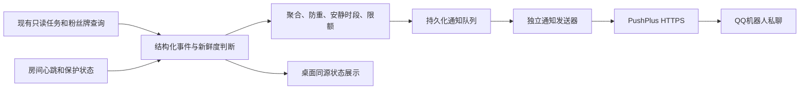

# BiliOshi 手机通知方案草案：PushPlus QQ

灰度状态：仅提交研究与实现代码，功能未启用，UI 不展示，旧配置不能恢复发送。

日期：2026-10-12。本文保留完整调研草案。用户随后将首版范围收窄为**仅每日总结**，已实现说明和操作步骤见 [每日总结使用指南](MOBILE_DAILY_SUMMARY.md)。本文中的增长、异常、下播推送与开放接口投递查询属于扩展设计，未接入当前版本。开发过程没有启用真实推送或要求用户在对话中提供 Token。

## 1. 推荐方案

BiliOshi 在主机上读取已核验的任务和亲密度，后台把增长摘要、收益停滞及账号异常发送到 PushPlus，由 QQ 官方机器人私聊通知本人。手机无需安装 BiliOshi，也无需 Codex 查询。

首版默认使用 **QQ 私聊 + txt 模板 + 短标题摘要**。配置完成并由用户显式启用后运行；不依赖会员。会员可获得更完整的正文展示。通知功能独立于弹幕、点赞与投喂开关。

这是接收通知方案。BiliOshi 主机仍须运行并联网；主机断电、断网或整个程序退出时，无法自行发出故障消息。第 10 节给出可选外部在线监测方案。

## 2. 官方文档的关键结论

| 项目 | 核验结果 | 设计选择 |
| --- | --- | --- |
| QQ 接入 | 添加并绑定机器人；`channel=qq`；不填 `option` 发给本人；填写配置编码选择群或指定机器人 | 首版使用默认机器人私聊，群推送作为高级选项 |
| QQ 展示 | 实名非会员只显示标题摘要；会员正文约 2000 字，txt 尽量完整展示 | 标题包含结论，正文压到 1200 字以内；实际标题摘要长度需手机验收 |
| 请求协议 | 支持 HTTPS；发送接口接受 JSON | 固定 `POST https://www.pushplus.plus/send`，Token 放 body |
| 同步响应 | 业务 `code=200` 代表受理，返回流水号；不等于最终投递 | GUI 显示“服务已受理”，单独管理投递核验 |
| Token | 消息 Token 可独立创建、删除；开放接口需要用户 Token | 首版使用专用消息 Token；投递自动查询作为可选增强 |
| QQ 日额度 | 实名 200 次、会员 1000 次；未实名无法调用发送接口 | 默认本机每日最多 100 次发送尝试，预留异常提醒容量 |

依据：[QQ 通道](https://www.pushplus.plus/doc/channel/qq.html)、[消息 API](https://www.pushplus.plus/doc/guide/api.html)、[HTTPS](https://www.pushplus.plus/doc/help/https.html)、[Token 区别](https://www.pushplus.plus/doc/help/token.html)、[额度限制](https://www.pushplus.plus/doc/help/limit.html)。此处是 2026-10-12 查阅到的规则，上线前再核对。

QQ 群使用的 `option` 是 PushPlus 配置编码，不是 QQ 群号；官方示例中的 `qqgroup` 也不是所有账号可通用的固定值。群配置不可同时填写 `topic` 或 `to`。[QQ 文档](https://www.pushplus.plus/doc/channel/qq.html)

## 3. 默认通知策略

所有时间使用 UTC+8；阈值、聚合间隔和开关属于本项目建议值。

| 事件 | 默认 | 触发及频率 | 手机标题示例（合成数据） |
| --- | --- | --- | --- |
| 亲密度增长 | 开 | 同账号、同日、同房间有效计数增加；60 秒聚合，同时合并多个房间 | `亲密度+3｜今日39｜2房增长` |
| 看播任务增长 | 开 | 看播进度增加；优先与亲密度消息合并；计数未确认时不声称收益到账 | `看播1/10｜主播A｜收益待核验` |
| 看播收益停滞 | 开 | 复用现有已核验的 stalled 判定：至少 30 分钟无进度且有足够成功心跳 | `看播30分无增长｜主播A 0/10` |
| 重建后仍未结算 | 开 | 现有恢复状态进入 pending_rewards；同次异常只通知一次 | `重建后仍无增长｜主播A 0/10` |
| 连接/收益恢复 | 开 | 曾经发出对应异常，随后确认连接恢复或进度增长；分别标注 | `收益恢复｜主播A 看播1/10` |
| 登录失效、保护暂停 | 开 | 保护状态真实变化；账号级合并，不按每个房间重复通知 | `账号保护暂停｜请检查登录` |
| 长期无法查询 | 开 | 连续 30 分钟无法取得有效任务/收益数据，明确显示“无法核验” | `收益无法核验｜数据已过期` |
| 开播 | 关 | 可选；确认开播状态转变后，每次直播一条 | `主播A开播｜已启动挂机` |
| 下播总结 | 开 | 先读取结束数据，再作一次延后 5 分钟只读核验；届时发送已确认部分 | `下播总结｜主播A 本轮+8` |
| 当日汇总 | 开 | 23:50 一条；属截至此时的累计快照，未结束房间标注“仍在播” | `10/12收益｜已核验合计+67` |

增长只在新的有效读数出现时推送；没有变化保持安静。QQ 不推送每分钟心跳、每条弹幕、每批点赞成功或重复错误堆栈。

### 安静时段

默认 00:00–08:00：普通增长观测写入独立的夜间摘要缓存，账号保护、连接异常、收益停滞仍提醒。08:00 用保留的有效观测生成一条新的夜间摘要，注明统计日期和观测区间；这是新摘要，不重发已过期的增长通知。旧开播通知到期即丢弃；如房间仍在播，摘要只描述最新已核验状态。已恢复的旧故障不在早晨重发。

“收益停滞”表示尚未确认结算，消息不能直接断言账号被风控。“连接恢复”也不能自动写成“收益恢复”。免费亲密度达限或任务已满应显示实际状态，不继续发停滞告警。

恢复消息关联同一个持久化异常编号：故障通知达到 accepted 或 provider_sent 时，允许生成恢复通知；不代表用户读过前一条消息。故障通知若仍是 pending、已过期或已确认投递失败，则关闭旧故障通知，不单独发“恢复”；可以进入普通增长摘要。前次提交为 unknown 时，发明确的“状态已恢复，前次提醒投递结果未知”状态摘要。`watch_progress_recovered` 仅作候选信号，实际收益恢复须有有效进度/计数增长证据，不能因跨日或短暂错误消失就认定恢复。

## 4. 收益计算与数据新鲜度

### 权威数据

- 每日亲密度使用 `get_my_medals` 中归一化的 `today_intimacy`，来自服务端 `today_feed` / `today_intimacy`。
- 任务进度使用 `get_fans_club_task_info` 的 `task_info`；按 `jump_type` 识别任务。
- `GetActivatedMedalInfo.intimacy` 是现有 UI 的等级经验数据，不能直接拿来替代“今日亲密度”。
- 心跳成功数、任务完成状态和实际亲密度分别呈现；不从它们推算固定收益。

目前 `WatchProgressMonitor` 每 10 分钟核验任务，桌面完整 probe 可能每 30 分钟才更新粉丝牌。要实现近实时增长提醒，需要补一个 **账号级、在播时每 10 分钟的只读粉丝牌刷新**，一次读取并共享给所有房间；不要每个 worker 各自重复扫描所有粉丝牌。

粉丝牌刷新须返回查询成功/失败、分页是否完整、账号、日期与真实查询时间。对选定主播缺失、分页不完整或错误结果，保存最后有效值及其时间，标注未知；不能补零。

同一 API 读取结果共享给桌面和通知服务；通知服务不另外发送弹幕、点赞、心跳或重建请求。在通知队列里重试只读查询，也不能绕过已有账号保护。

### 增量规则

```text
身份一致 + 日期一致 + 两次有效计数 + 当前值不小于上次值
  → 观测增量 = 当前今日亲密度 − 上次今日亲密度
```

- 首次启动、换账号和跨日：建立新基线，已有收益不报成刚获得的增长。
- 每日计数回退：标记异常并重新核验，不计算负增长，也不直接当作新基线制造后续假增长。
- 昨日到今日的 40 → 0 是跨日重置，不是收益损失。
- 每日汇总对每个配置房间只计一次，不累加各次挂机会话的今日累计值。
- 今日总数只有在所有目标房间的有效读数齐备时才叫“合计”；部分数据缺失则写“已核验 3/7 房合计 +X，另 4 房未知”。
- 跨日挂机的本轮增长需分日记录；证据不足时显示“本轮增量无法确认”。
- 上限、亲密度结算停滞等展示保留查询时点，不输出“任务全满所以亲密度必满”。

建议粉丝牌新鲜度上限 13 分钟（10 分钟周期 + 3 分钟余量），任务使用现有核验时间；超过上限不能显示“当前收益已确认”。正常增长通知约在 10–12 分钟内生成，主机调度及 PushPlus/QQ 延迟另计，不承诺秒级。

## 5. 消息内容和请求

标题结构：**结论 → 核心数值 → 简称**，通常 20–35 字；较长主播名截断，关键结论放在最前。这是本项目排版目标，不是 QQ 摘要长度保证。

示例标题：`亲密度+1｜主播A 今日27`

示例正文：

```text
BiliOshi｜10月12日 21:40（UTC+8）
主播A：本次观测 +1，今日累计 27
看播：1/10；弹幕：10/10；点赞：10/10；灯牌：0/1
连接：正常；收益：已确认本次增长
说明：增长来源未单独归因，任务与亲密度分别核验。
数据查询：21:40；监控在线。
```

无有效亲密度读数时，正文改为“今日亲密度未知；最后有效值 26，查询于 21:20”，不能把 26 包装成 21:40 的新数据。

拟发送请求（占位 Token，示例本身不执行）：

```http
POST https://www.pushplus.plus/send
Content-Type: application/json
```

```json
{
  "token": "<LIVESUPPORT_MESSAGE_TOKEN>",
  "title": "亲密度+1｜主播A 今日27",
  "content": "本次观测+1；今日累计27；看播1/10。数据查询21:40（UTC+8）。",
  "channel": "qq",
  "template": "txt"
}
```

私聊默认不发送 `option`、`topic`、`to`。高级指定机器人或群模式才添加用户选择的配置编码。发送时可附 `timestamp=expires_at_ms`，作为过期截止时间；**它不是防重复请求 ID**。防重由本地事件键和账本完成。[消息 API](https://www.pushplus.plus/doc/guide/api.html)

## 6. 接入架构与已有代码



| 现有位置 | 已确认能力 | 计划接入方式 |
| --- | --- | --- |
| `bilioshi/context.py`、`application.py` | 注入 observer、notify，GUI 和 CLI 共用 AppContext | 同一个通知协调器；observer 只入队，notify 兼容尚未结构化的旧事件 |
| `bilioshi/runtime.py::append_event` | 日志事件含时间、来源、房间及会话信息 | 组合原有 recorder 与通知事件收集器，保持原观察者行为 |
| `services/watch_progress.py` | watch_progress、warning、recovered、reconnect、pending_rewards | 直接依据事件和已核验状态生成异常通知，避免解析日志文本 |
| `desktop/worker.py::RoomStateRecorder` | 房间状态持久化 | 保留原记录；多个进程只生产事件，不各自请求 PushPlus |
| `desktop/view.py`、`engine.py` | 托盘开播与收益异常通知 | 继续本机提醒，手机通知从后台服务发出；窗口关闭后仍可发送 |
| `desktop/snapshot.py` | 区分任务新鲜度与今日亲密度 | 复用校验规则；新粉丝牌刷新提供独立时间戳，避免新任务让旧收益变“新” |
| `bilioshi/daily_summary.py` | 过去 N 小时会话日志汇总 | 可以提供说明字段；每日收益金额使用当日有效计数另行聚合 |

拟新增 `notifications/{events,policy,store,pushplus,dispatcher}.py`，分离业务判定、存储和网络。GUI 只配置、展示通知状态和发起测试；核心不导入桌面模块。

结构化事件是手机通知的主入口。同一事件已有结构化记录时，旧 `_notify` 文本和 GUI 托盘提示不再生产第二条手机通知，避免开播、停滞被多个入口重复发送。

通知使用独立的固定域名 HTTPS 客户端，只携带 PushPlus 凭据和允许的内容；现有 B 站 HTTP 客户端的会话头、保护状态与动作预算保持其账号职责。PushPlus 故障单独记录为“通知通道异常”，不把 BiliOshi 的 B 站账号暂停。

### 持久化和并发

- 队列位于运行数据目录的 `state/notifications.sqlite3`，采用 SQLite 事务和唯一事件键。
- 同一运行数据目录仅一个 dispatcher，通过进程锁选出；GUI 和 CLI 共用它。不同安装目录指向相同 PushPlus 账号时不能保证共享额度，应提示用户避免双开，或交由独立通知服务统一调度。
- 多个 worker 的通知观察者仅做短时入队；入队超时/失败只记脱敏错误，不能向心跳调用栈抛出通知异常。
- 预留发送尝试次数、领取队列任务与写入 submitting 状态在事务中完成，随后执行网络请求。
- 程序在 submitting 后崩溃，重启将其视为结果未知，不自动重放。
- 普通增长防重键包含本地账号隔离键、日期、房间、事件类别和有效计数。故障防重键使用账号、房间、类别、持久化 episode_id 与阶段，不把日期作为故障重新发送的理由。
- 异常由“正常 → 异常”的已核验状态转变建立 episode_id，恢复后关闭；同日再次发生建立新编号。程序重启、跨日和临时查询失败沿用未关闭编号；跨日计数重置本身不关闭收益异常。不把私人账号键或原始异常编号发送到 QQ。
- 事件状态至少包含 pending、submitting、accepted、provider_sent、failed、unknown、expired、superseded。provider_sent 只是供应商报告发出，不等于手机弹窗或用户已读。
- 队列正文只存必要字段，不存 Cookie、完整接口响应或错误堆栈。记录默认保留 7 天，每日清理；Token 不放队列。

旧历史日志不用于首次启动的手机补发。首次启用先建立基线，确保不会把几天前的收益和故障推到手机。

## 7. 防刷屏、额度和故障处理

建议本机发送间隔至少 30 秒；增长事件按 60 秒聚合。同房间同计数/同异常阶段只入队一次，短暂查询失败不重新激活同一警告。多个房间同时故障合成一条；增长恢复只在对应异常之后通知。

额度限制文档列出保守频率参考及相同内容限制，并说明错误请求也消耗次数。QQ 的日额度与微信额度不同，不能把微信会员的 2000 次套用给 QQ。[额度说明](https://www.pushplus.plus/doc/help/limit.html)

推荐本机每日发送尝试上限 100 次：普通消息在总尝试达到 80 次后转为缓存汇总，重要异常可使用剩余容量。测试请求和失败尝试也计数。这个上限不能保证整个 PushPlus 账号剩余额度，因为其他软件可能使用同一账号。

| 情况 | 行为 |
| --- | --- |
| HTTP 成功且业务 code=200，有流水号 | 标记 accepted，保存流水号；不再次提交同一消息 |
| 明确未提交的本地/DNS 失败 | 最多再尝试两次，间隔 60 秒、5 分钟，仍受过期和日额度控制 |
| 请求超时、断连、响应无效、HTTP 5xx | 可能已受理，记 unknown；不自动重发，防止重复提醒 |
| 明确频率拒绝 | 冷却 5 分钟；只有确认未受理且消息仍有效时有限重试 |
| 业务 code=900 | 持久化暂停通知通道，提示检查额度/限制；不因换日自动清除此保护 |
| 903、905 或绑定/配置错误 | 停止后台重试，GUI 显示需要更新 Token、实名或绑定；用户修复后主动恢复 |
| 不同消息连续三次网络/服务异常 | 通知发送器暂停 5 分钟，保留未过期队列；B 站任务继续按原策略运行 |
| 本机额度已满 | 保存最新摘要及遗漏计数，本机提示；次日只发送仍有意义的合并信息 |

返回码依据：[官方返回码](https://www.pushplus.plus/doc/guide/code.html)。不要仅根据 HTTP 200 判断业务成功。

普通增长有效期 30 分钟；开播有效期 10 分钟；故障消息最多保留 2 小时且发送前核对故障仍存在。恢复、下播和日报消息保留明确观测时间，原则上当天发送。队列中旧增长被新摘要替代；跨日旧值保留日期，不与今日累计混算。夜间摘要缓存保存观测到 08:00 合并完成（最多 24 小时），与待发消息的 TTL 分开；缓存生成的新摘要也必须通过发送限额和时效检查。

### 投递核验的权限分层

基础版只使用消息 Token，能确认服务受理并提供流水号；最终结果由用户在 PushPlus 消息记录中查看，GUI 不伪装成“手机已收到”。

可选增强版使用开放接口的 `sendMessageResult`：需要用户 Token、secretKey、启用开放接口与安全 IP 配置，取得 AccessKey 后通过 `access-key` header 查询。消息 Token 不能用于这个流程。只有一个协调器刷新 AccessKey，防止进程互相覆盖；查询最多 3 次，例如 5/20/60 秒后，未完成则保留“待核验”。[开放接口文档](https://www.pushplus.plus/doc/guide/openApi.html)

首版不要求公网回调服务器；上述增强不会混入基础配置。即使状态为“已发送”，仍需在测试时确认手机能收到通知及 QQ 通知权限。

## 8. GUI 与配置

新增“手机通知”设置页，默认关闭：

1. PushPlus 消息 Token：密码框，单独加密保存，界面不回显。
2. 目的地：默认“QQ 私聊本人”；高级选项为配置编码。
3. 展示模式：默认“精简标题”；会员可选详细正文。
4. 开关：增长、看播进度、异常、恢复、下播总结、每日汇总、可选开播。
5. 默认聚合 60 秒、日报 23:50、安静时段 00:00–08:00、日上限 100。
6. “测试通知”：明确执行一次真实发送；先显示标题预览和目的地，再由用户点击。
7. 最近状态：未配置/排队/已受理/供应商已发出/结果未知/失败/额度暂停；显示时间、脱敏错误及队列数量。
8. 独立的“暂停手机通知”“恢复通知”和“清空待发通知”按钮，操作不改变账号挂机保护。

普通开关与参数保存在 settings；消息 Token 使用现有 secret_store 的 DPAPI/系统凭据库能力，独立于 B 站登录文件，不进入 settings、公开日志或 Git。清空待发通知不清除防重记录和当日发送尝试预算。

拟配置（不含秘密）：

```json
{
  "mobile_notifications": {
    "enabled": false,
    "channel": "qq",
    "option": null,
    "template": "txt",
    "compact_title": true,
    "aggregate_seconds": 60,
    "minimum_send_interval_seconds": 30,
    "daily_attempt_limit": 100,
    "normal_attempt_threshold": 80,
    "quiet_hours": ["00:00", "08:00"],
    "critical_during_quiet": true,
    "summary_at": "23:50",
    "timezone": "Asia/Singapore",
    "delivery_verification": "manual"
  }
}
```

消息会经过 PushPlus 和 QQ。首次启用告知并允许选择发送主播简称、收益、进度或仅匿名异常；不附真实账号 UID、昵称、电脑用户名、路径、设备标识、原始请求和登录凭据。群推送额外展示目的地并由用户明确启用。

## 9. 用户配置步骤

1. 注册/登录 PushPlus，完成发送所需实名。
2. 在渠道配置的“QQ机器人”中扫码添加并绑定官方机器人；已添加时按页面发送绑定码。
3. 为 BiliOshi 创建一个可撤销的专用消息 Token。
4. 将 Token 填入软件本地设置，目的地选择 QQ 私聊本人。
5. 手机允许 QQ 通知，取消该机器人会话免打扰；软件中预览并点击一次“测试通知”。
6. 手机确认标题能读到关键结论后启用自动通知。

手机通知配置无需额外提供 B 站 Cookie；私人任务和收益读取仍使用 BiliOshi 已有的有效登录。Cookie 不发送到 PushPlus、QQ 或对话，PushPlus Token 只填入软件本地设置。首次配置的扫码、实名、手机通知权限属于用户操作；正式配置时完成即可，本轮草案无需等待这些步骤。

如果免费 QQ 标题摘要不足以满足详细日报需求，可选 PushPlus App 渠道：官方文档说明可在本机消息中查看详情并接收手机系统通知；需安装 App 并允许通知。这个选项复用通知事件与队列，只更换发送渠道，实际免费显示效果仍须手机验收。[App 文档](https://www.pushplus.plus/doc/channel/app.html)

## 10. 可选：主机消失提醒

仅使用主机上的发送器不能覆盖主机断电和完全退出。需要这一能力时增加一个独立外部在线检查器，保持默认关闭，作为第二期扩展：

- 主机每 10 分钟提交一次匿名安装 ID、报告时间、期望运行状态；用独立密钥认证，无 B 站凭据或原始收益数据。
- 外部检查器每 5 分钟检查。期望运行却超过 20 分钟没有新报告，只发一次“主机报告中断，可能断网、退出或断电”；恢复后发一次恢复通知。
- 用户正常关闭前标记“不再期望在线”；如果此报告发送失败，外部无法区分主动退出与故障，仍只能写“报告中断”。
- 手动暂停挂机会停止收益停滞告警；是否继续检查程序在线由用户的期望状态决定。
- 外部检查器可使用另一个专用消息 Token，但同一 PushPlus 账号仍共享服务额度。外部自行限额，主机健康摘要保持非强保证。
- 外部检查器也可能故障，QQ 也可能延迟；该扩展提供额外发现能力，不保证所有离线事件均被通知。

首版手机查看增长无需外部服务器；也不承诺用户能在 QQ 中远程补齐任务、解除保护或直接查询 B 站账户。这些动作需要另外的认证与控制设计。

## 11. 实现顺序与验收

以下第一、第二批共同构成支持本文默认策略的首版，属于开发拆分顺序，不代表只完成第一批就已交付所有默认通知。持久化防重、重启防重、发送限额、未知结果处理必须在自动发送启用前完成。

### 第一批：可用通知链路

事件模型、粉丝牌只读刷新、消息策略、持久化队列、独立发送器、DPAPI Token、GUI 设置和测试通知；默认关闭，支持私聊。GUI/CLI 使用同一服务，关闭主窗口但保留托盘时仍可通知。

### 第二批：完善观测与可靠性

异常恢复、重建后无结算、下播延后核验、日报、安静时段、通知保护恢复和重启防重；可选开放接口投递核验。

### 第三批：可选扩展

外部主机在线检查、群通知和 App 渠道。各自单独开关，不将付费会员或开放接口权限作为基础版前置条件。

必须覆盖的验收：

- 离线测试增长、计数回退、跨日、缺页、查询失败、新任务与旧收益混合；不将未知显示为 0。
- 多进程同时生产同一事件、重启恢复、提交时崩溃、Token 更换、停止/恢复及清空队列后防重仍有效。
- 模拟受理后延迟、code=900/903/905、超时无流水号、HTTP 5xx、持续故障与本机额度达到上限。
- 慢通知和通知入队失败不打断看播心跳；QQ 不可用不触发 B 站保护暂停。
- 真实测试只发一次合成通知，再确认手机标题、正文、免打扰和系统通知权限；该测试不操作直播账号。
- 用合成收益事件演练增长、停滞、恢复、当日汇总，避免为验收制造真实账号风控或发送直播互动。
- GUI 控件测试、公开信息扫描及构建检查；不公开 Token、接收目标或私人通知流水。

本方案完成的是研究和设计。真正的 Token 配置、真实消息测试及代码交付在后续实现阶段进行。
